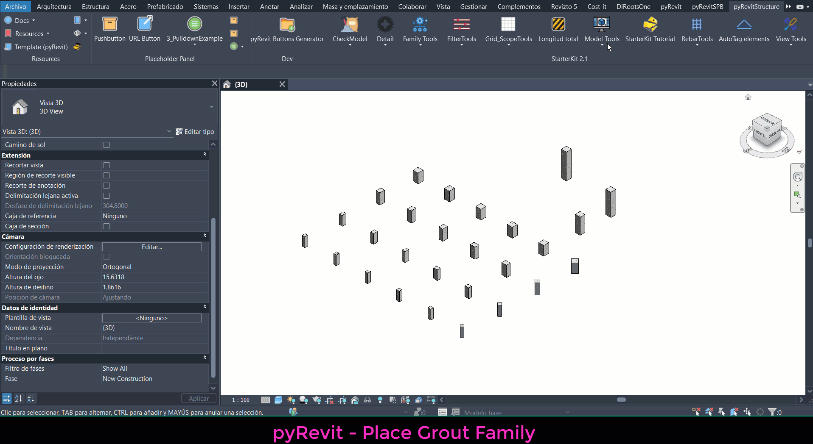

## Grout Column

A pyRevit tool for automatically creating grout elements at the top of selected structural columns.

The tool places a grout family instance based on the dimensions and position of the selected columns. It automatically retrieves the column width and depth, applies the column rotation, and allows users to configure the grout thickness, family, and material.

## Features

- **Family Selection:** Choose the grout family from the families available in the Revit project.
- **Automatic Dimensions:** Retrieve the width and depth of structural columns using the `b` and `h` parameters.
- **Thickness Control:** Define the grout thickness in millimeters.
- **Material Assignment:** Select and assign a material to the generated grout elements.
- **Rotation Handling:** Automatically match the grout element rotation to the corresponding structural column.
- **Parameter Assignment:** Optionally assign the grout dimensions to the generated family instance.
- **Comments:** Optionally assign an instance comment to identify or describe the generated elements.
- **Batch Creation:** Select multiple structural columns and generate their corresponding grout elements in one operation.

## Requirements

- Autodesk Revit
- pyRevit installed and configured.
- Structural columns with the required parameters:
  - **b** – Column width.
  - **h** – Column depth.
- A grout family loaded into the Revit project.
- Available materials in the Revit model.

## Inputs

The tool provides a WPF interface where users can configure:

- **Grout Family:** Family used for the generated grout elements.
- **Material:** Material assigned to the grout elements.
- **Grout Thickness:** Thickness defined in millimeters.
- **Assign Parameters:** Optional setting to control whether the grout dimensions and comments are assigned.
- **Comment:** Optional instance comment for the generated elements.

## Usage

1. Install pyRevit in Autodesk Revit.
2. Add the tool to a pyRevit extension.
3. Open the **Grout** tool from the pyRevit ribbon.
4. Configure the grout family, material, and thickness.
5. Optionally enable parameter assignment and enter a comment.
6. Select the structural columns where grout elements will be created.
7. The tool automatically generates the corresponding grout instances.

## Important Notes

- The selected elements must be structural columns.
- Column families must contain the parameters **b** and **h**.
- The grout family must be loaded into the active Revit project.
- The generated grout element is created as a structural column family instance.
- The grout dimensions are obtained from the selected column parameters when parameter assignment is enabled.
- Column rotation is automatically applied to the generated grout element.
- Material assignment is performed independently of the optional parameter assignment setting.

## Installation

The tool is distributed as part of a **pyRevit extension**.

To install it:

1. Download or clone this repository.
2. Copy the extension folder into a pyRevit extensions directory.
3. Reload pyRevit or restart Revit.
4. Run the **Grout** command from the pyRevit ribbon.

## Demo

Workflow example:

